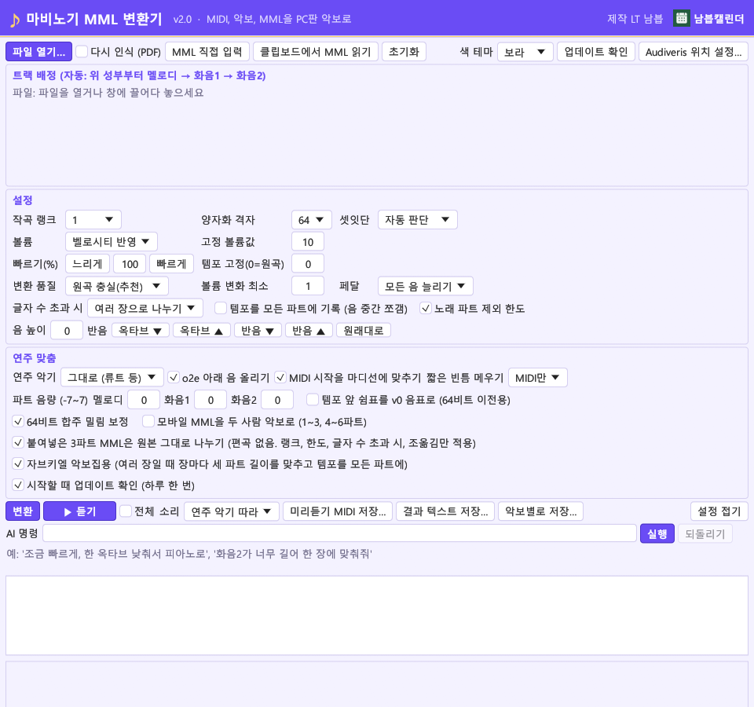
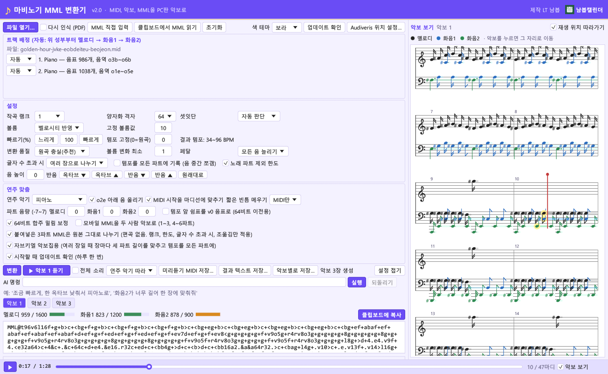
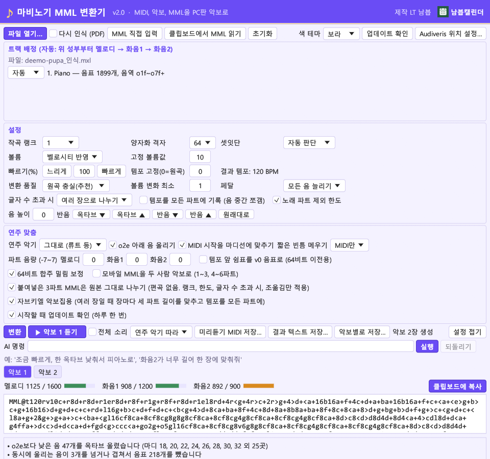
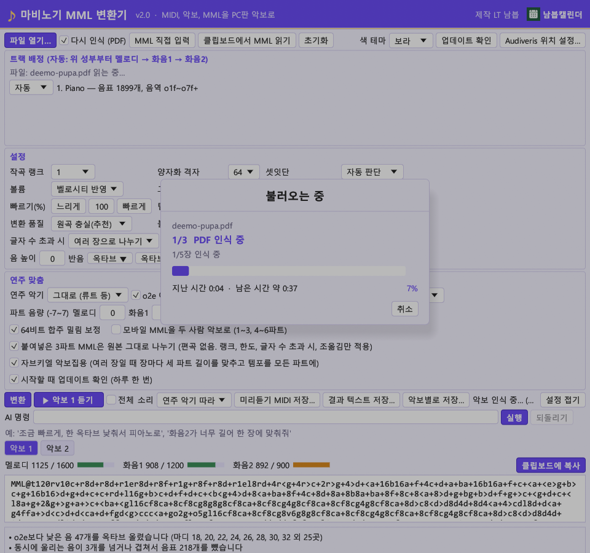
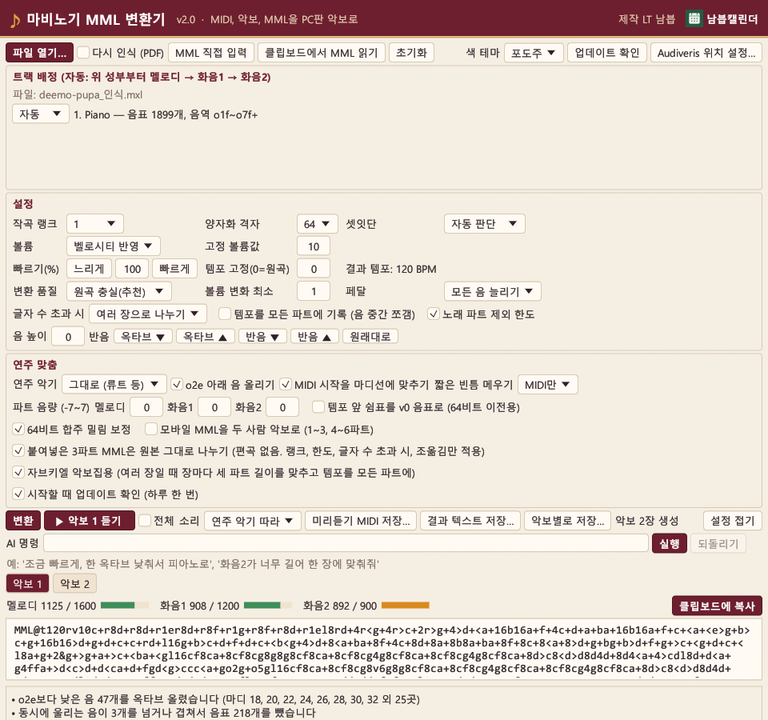

# 마비노기 MML 변환기 v2.4.6 (Rust판)

MIDI · MusicXML · 악보 PDF/이미지 · 이미 만든 MML 을 PC판 마비노기 작곡 악보(`MML@멜로디,화음1,화음2;`)로 바꿔 주는 프로그램입니다.
파이썬판 v1.6 의 모든 기능을 Rust 로 처음부터 다시 만들었고, **같은 입력·같은 설정이면 결과 MML 이 파이썬판과 글자 하나까지 같습니다** (아래 비교표).

제작: **LT 남븝** · 남븝캘린더: https://nambebmabi.com/



## 기능 (파이썬판 v1.6 과 같음)
- 불러오기: MIDI(.mid/.midi/.rmi/.kar), MusicXML(.musicxml/.xml/.mxl), 악보 PDF/이미지(Audiveris 를 그대로 호출), MML 텍스트(.txt/.mml), 클립보드의 MML, 창에 끌어다 놓기
- **불러오는 중 창**: PDF 인식이나 큰 파일을 열면 단계(PDF 인식 → 악보 읽기 → MML 만들기), 진행 막대, 지난 시간, 남은 시간 예상, 취소 버튼. Audiveris 기록에서 몇 장 중 몇 번째 장·단계인지 읽어 진행률을 계산하고, 걸린 시간을 기억해 다음 예상에 씁니다. MML 만들기도 백그라운드에서 해 창이 멈추지 않습니다.
- 작곡 랭크별 글자 수 한도, 한도를 넘으면 여러 장으로 나누기(마디 단위) / 앞부분만 / 그대로
- 품질 프리셋(원곡 충실 · 균형 · 글자 수 절약 · 한 장에 자동 맞춤), 격자·셋잇단·볼륨·페달·빈틈 메우기
- 연주 악기별 높이 보정, 음 높이 버튼(옥타브/반음 ▲▼, 원래대로), 빠르기·템포 고정, 파트 음량
- 원본 MML 붙여넣기 · **MML 직접 입력 창**(조각 칸 추가·이어 붙이기), 모바일 MML 6파트, 두 사람 악보로 나누기
- **자브키엘 악보집 옵션**(여러 장일 때 장마다 세 파트 길이·템포 맞춤), 64비트 합주 밀림 보정
- **미리듣기**: Windows 기본 신시사이저로 연주 악기와 비슷한 소리로, 템포 변화를 실제 시간으로 풀어 재생. 미리듣기 MIDI 저장
- **악보 보기와 재생 위치 바 (v2.1)**: 창 오른쪽에 재생할 MML 을 큰보표 악보로 그려 재생 위치(빨간 선)와 지금 나는 음을 보여 줍니다. 결과창의 MML 을 고치면 악보가 바로 바뀝니다. 창 아래 재생 위치 바를 끌거나 악보를 누르면 그 자리로 옮겨 듣습니다.
- **악보 마디 겹침 고침 (v2.2)**: 악보 인식(PDF/MusicXML) 결과에서 마디가 `<backup>` 으로 끝나거나 마지막 성부가 짧으면 다음 마디가 일찍 시작해 두 마디가 겹치던 것을 고쳤습니다. 다음 마디는 그 마디에서 가장 멀리 간 위치에서 시작합니다.
- **합주 (v2.3)**: 설정에서 합주를 켜고 합주자 수(자동, 2~8명)를 고르면, 곡을 여러 사람이 함께 치도록 나눕니다. 합주자마다 멜로디·화음1·화음2 악보가 따로 생겨 혼자 칠 때 빠지던 겹친 음을 살립니다. 자동은 음을 빼지 않고 모두가 악보 한 장에 들어가는 가장 적은 인원을 고릅니다. 합주자를 골라 보고, 파트별로 복사하고(멜로디/화음1/화음2 복사), 악보 보기 위 '듣기'에서 원하는 합주자만 골라 함께 들을 수 있습니다. 여러 장이 되면 모든 합주자를 같은 마디에서 자르고 장 길이를 맞춰 장이 바뀔 때도 싱크가 맞습니다 (v2.3.1). 명령줄 `--players N|auto`.
- **원곡 악기별 합주 (v2.4)**: 합주 '나누기'에서 '원곡 악기별로'를 고르면 원곡 트랙마다 어울리는 마비노기 악기(피아노·바이올린·베이스 등)를 정해 합주자를 따로 두고, 합주자마다 그 악기 옥타브와 미리듣기 소리를 씁니다. MIDI 드럼 트랙은 마비노기 드럼 세트 배치(킥 o2f, 스네어 o2a, 고스트 o3d, 하이햇 o3a/o3g …)로 옮겨 드럼 합주자로 나옵니다. 악보 보기에서 합주자마다 큰보표를 따로 그립니다.
- **악기 (v2.4)**: 가야금·베이스·전기기타, 10주년·축제 악기, 새 악기 추가. 휘슬·론카도라·플룻·샬루모·튜바·가야금 등은 적을 수 있는 음역 밖 음을 옥타브로 옮기고 마디 번호를 알립니다. 실로폰(핸드 차임)은 한 파트·v11까지.
- **글자 수 줄이기 (v2.4)**: 옥타브 경계 음은 c-·b+, 멀리 떨어진 한 음은 n번호로 적습니다 (끌 수 있음).
- **모바일용 저장 (v2.4)**: 한 사람 6파트, 파트마다 2400자, 빈틈 메우기로 바꿔 저장하고 첫 장을 복사합니다.
- **v2.4.1**: 합주자마다 연주 악기를 따로 고르기(합주자 1명 + 드럼도 가능, AI 명령으로도), 긴 MIDI에서 악보 보기를 쪽으로 나눠 그리기, 악보 단추 여러 줄, 재생 중에 다른 악보를 누르면 바로 그 악보 재생.
- **v2.4.2**: AI 명령이 MML을 직접 고칠 수 있음(특정 음·마디 고치기 등, 문법 검사와 되돌리기). 피아노·리라·하프·실로폰·첼로·바이올린 음역을 넣어 'o2e 아래 음이 안 날 수 있다'는 잘못된 안내를 없앰.
- **v2.4.3**: 악보 보기에서 악보(장) 경계와 이름을 표시하고 장마다 바탕을 번갈아 칠함(고른 장은 진하게). 합주·전체 보기에서 악보 단추를 누르면 그 장으로 이동.
- **v2.4.4**: 드럼 트랙이 없는 곡도 합주에서 박자에 맞춘 드럼(킥·스네어·하이햇, 8마디마다 크래시와 필인)을 자동으로 만들어 드럼 세트 합주자로 넣을 수 있음 (AI 명령, `--auto-drums`). AI 답 대기 시간 300초.
- **v2.4.5**: 악보 보기를 프로그램 오른쪽에 따로 띄우는 창(크기 조절, '창 합치기'). 재생 위치 따라가기 버그 고침(재생선이 뒤로 튀며 화면이 왔다 갔다 하던 것, 쪽 어긋남 등).
- **v2.4.6**: 자동 드럼 모양(기본·풍성하게·단순하게). AI 명령 권한 확대: 설정과 MML 고침을 한 명령에, 장 전체 다시 쓰기·새 장 붙이기, 새 반주·드럼 리듬 쓰기, 트랙 배정 바꾸기 (문법 검사·파트 길이 검사·되돌리기).
- 결과 텍스트 저장, 악보별 저장, 초기화, 보라/포도주 색 테마, 설정 기억
- **자동 업데이트**: GitHub 릴리스(태그 `vX.Y`, 자산 `MabiMML_vX.Y_PDF.exe` 또는 고정 이름 `MabiMML_PDF.exe`)를 하루 한 번 확인
- **AI 명령**: 웹서버 중계(`https://nambebmabi.com/mabimml/ai`)로 Claude 에게 묻고 설정만 바꿉니다. **앱과 저장소에는 API 키가 없습니다.** 요청 형식은 파이썬판 v1.6 `ai.ask_relay` 와 바이트까지 같습니다 (`docs/AI_중계_요구사항.md`).

## 화면


| 곡 불러온 화면 | 불러오는 중 창 (PDF 인식) | 포도주 테마 |
|---|---|---|
|  |  |  |

## 파이썬판과 결과 비교
`tools/compare_with_python.py` 가 같은 입력과 옵션으로 두 명령줄판을 돌려 **결과 텍스트, 악보별 저장 파일, 미리듣기 MIDI** 를 바이트 단위로 비교합니다.
시험 곡 18개(MIDI 12개, 인식된 MusicXML 3개, MusicXML 예제, 시험MML, MabiIcco 파일) × 옵션 12가지 = 216번 → **216번 모두 같음**. 결과표: `docs/compare_report.md`.

```bash
python tools/compare_with_python.py "D:\MML\마비노기MML변환기"
```

## 만들기 · 시험
Windows + Rust(MSVC 툴체인, `rust-toolchain.toml`) 와 Visual Studio C++ Build Tools 가 필요합니다.

```bash
cargo build --release
```

```bash
cargo test
```

- `target/release/mabimml.exe` : 창 프로그램 (파일을 실행 아이콘에 끌어다 놓아도 열림)
- `target/release/mabimml-cli.exe` : 명령줄판 (파이썬판 `python -m mabimml` 과 같은 옵션)
- PDF 인식은 exe 옆(또는 위 폴더)의 `audiveris` 폴더, 설정한 위치, 설치된 Audiveris 순으로 찾습니다. Java 포함 Audiveris 는 저장소에 넣지 않습니다.
- 시험은 파이썬판 `tests/test_roundtrip.py`, `test_progress.py`, `test_ai_relay.py`, `test_updater.py` 를 옮긴 것입니다 (`tests/`, 각 모듈의 단위 시험).
- 창 캡처: `MABIMML_SHOTS=폴더` 로 실행하면 기본 화면, 곡 불러온 화면, 불러오는 중 창, 포도주 테마를 자기 창에서 찍고 스스로 닫힙니다.

설정 파일은 `%USERPROFILE%\.mabimml-rs.json` (파이썬판 설정과 따로).

## 배포 exe (PDF 포함판, 한 파일)
`mabimml.exe` 뒤에 Audiveris(자바 포함) 폴더를 압축해 붙여 한 파일로 만듭니다. 처음 악보 PDF 를 읽을 때
`%LOCALAPPDATA%\MabiMMLudiveris_<해시>` 에 한 번만 풀어 쓰고, 새 판이 나오면 이전 폴더는 지웁니다.

```bash
cargo build --release && target/release/mabimml-pack.exe target/release/mabimml.exe <audiveris 폴더> MabiMML_v2.4.6_PDF.exe
```

릴리스 자산은 `MabiMML_vX.Y_PDF.exe` 와 같은 파일의 고정 이름 `MabiMML_PDF.exe`, 그리고 `MabiMML_vX.Y_LICENSES.txt` 입니다.
파이썬판 v1.6 의 자동 업데이트도 이 이름을 찾으므로 v1.6 사용자는 v2.0 을 업데이트로 받습니다.

## 폴더
```
src/        엔진(model, mml_parser, encoder, arrange, midi_io, musicxml_io, mobile_io, mml_split, convert, omr, progress)
            창(gui, theme), 미리듣기(player), 자동 업데이트(updater), AI 명령(ai), 명령줄(cli)
tests/      옮긴 시험과 시험 자료
tools/      파이썬판 비교 스크립트
assets/     아이콘, 남븝캘린더 그림
screenshots/ 실제 창 캡처
라이선스/    함께 쓰는 프로그램(Audiveris)의 라이선스
```
